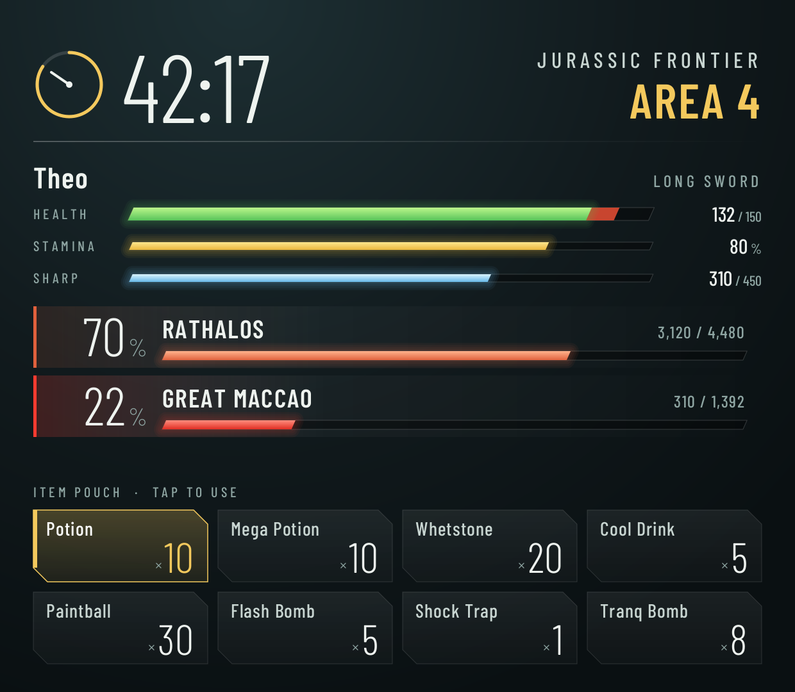

# Companion panel on a second screen (AYN Thor)

On a device with two displays the Android app shows a panel on the display the game is not on: the quest's time left
and area, the hunter's HP, stamina and sharpness, the large monsters' HP and the item bar. With one display nothing
changes. A touch on an item of the item bar uses it: the hunter takes it as if it had been picked on the bar and Y
pressed.

(The picture is `CompanionView.java` itself drawing sample values on a PC, through stand-ins for Android's drawing
classes: the layout is the real one, the fonts' rendering and the glow are only close. Not a capture from a device.)

This fork's APK has its own app id, `io.github.yurushia.mhgurecomp.thor` ("MHGU Recomp Thor"), so it installs beside the
original app; its folder is `Android/data/io.github.yurushia.mhgurecomp.thor/files/` (where the README says
`Android/data/io.github.morerokk.mhgurecomp/files/`).

**Status: not tested on a device or in a running game.** The C side passes a syntax check and the Java side compiles
against android-35; the offsets are from reading the game's code (main 1.4.0) and the port's notes.

| file | what |
|---|---|
| `runtime/hle/companion.c`, `.h` | reads the game ten times a second on the game's thread (from the input polling, after `presence_tick`) and keeps the state as a JSON text; the header comment lists every offset and the JSON's fields |
| `runtime/hle/companion_items.h` | item number -> English name (generated from the MHGU Modding wiki's Item IDs page) |
| `android/java/.../Companion.java` | finds the other display, shows a `Presentation` there (its window never takes the focus), polls the JSON through JNI |
| `android/java/.../CompanionView.java` | draws it, on a 1240 x 1080 sheet scaled to the display, and takes the touches |
| `android/assets/fonts/` | Barlow Condensed (SIL Open Font License), packed into the APK by `android/apk.mk`; without them the system's condensed face is used |

Checking the values without a second screen, on any platform: `MHGU_COMPANION_LOG=1` (Android: a line in `env.txt`)
logs the JSON once a second as `[companion] {...}` in `log.txt`.

Using an item (`companion_use` / `companion_buttons`, after the RadialMenu Forge plugin): once the hunter may pick an
item the slot is selected and Y is held on the pad for a moment; if the game didn't take it (the hunter not busy, the
count unchanged) Y is pressed again, up to four times. To check on a device: with the weapon out Y may only sheathe it
(a second touch would then be needed), `[Actions] Enable=1` may not pass the pad's Y on, and a touch on the second
display must not take the controller's events away from the game.

Not there yet: the map with the hunter's and the monsters' positions (the positions are
already in the JSON), other hunters' HP, a Prowler's item bar.
